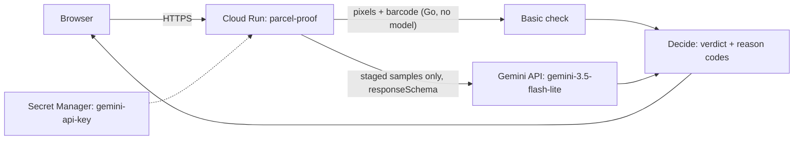

# ParcelProof by Jeejak

**Will this packing photo win the dispute?** ParcelProof checks, right after packing, whether an online seller's photos would hold up as proof in a Shopee or TikTok Shop dispute, using Gemini on Google Cloud.

**Live demo:** `LIVE_URL` (no login; staged sample parcels are preloaded)
**Built for:** AI Builder Cup 2026, Retail & Commerce: Intelligent Customer and Business Experiences

---

## The problem

Indonesian online sellers lose marketplace disputes every day. A buyer claims an item was missing or the parcel was empty, the marketplace asks for proof, and the seller's photo turns out to be useless: too dark, the shipping label cut off, the box never shown sealed. They find out days later, when the parcel is gone and nothing can be re-shot.

Our app, [JejakPaket](https://play.google.com/store/apps/details?id=id.jeejak.paket), records proof for every package: resi (waybill) scan, packing photos, handover video. ParcelProof is its AI layer. It tells the seller whether the proof they just captured is strong, worth a second look, or weak, and why.

## What it does

For one parcel's packing photos, ParcelProof returns a verdict, **Bukti kuat** (strong), **Perlu dicek** (worth a look) or **Bukti lemah** (weak), with reason codes:

| Reason | Meaning |
|---|---|
| `image_dark`, `image_blurry`, `image_obstructed` | the photos cannot show anything |
| `label_not_visible`, `label_unreadable` | no readable shipping label in any photo |
| `label_mismatch` | the label's tracking number is not this order's |
| `item_not_visible` | the item never shown before the box was closed |
| `not_sealed` | the box never shown sealed |
| `koli_mismatch` | fewer parcels in the photos than the order has |

Two checks run side by side:

- **Gemini check.** Gemini reads the whole photo set and reports what it sees in a fixed JSON schema. Covers all nine reasons.
- **Basic check.** Brightness, sharpness and the shipping barcode, measured in Go. No model, no cost, and the photos never leave our server. Covers darkness and blur.

## How we use Google AI

- **Model:** Gemini 3.5 Flash-Lite (`gemini-3.5-flash-lite`), multimodal, called through the Gemini API (Google AI Studio key) from [`gemini/client.go`](gemini/client.go). The same client speaks to **Vertex AI**, which is our production path for real seller photos.
- **Structured output only.** The request carries a `responseSchema` ([`evidencecheck/checker.go`](evidencecheck/checker.go)). Gemini answers six fields (`image_usable`, `label_visible`, `label_resi_read`, `package_sealed`, `item_visible`, `koli_seen`) and nothing else. A response that does not fit the schema is discarded, never repaired. "unsure" is a valid answer and never turns into a warning.
- **The model observes, our server decides.** A pure Go function, [`evidencecheck.Decide`](evidencecheck/verdict.go), turns the observation into the verdict. Sellers see fixed Indonesian strings keyed on reason codes, never model text.
- **The model is never told which tracking number to expect.** It transcribes the label; the server compares. A misread can produce "label doesn't match, please check", but a wrong tracking number can never end up in a document a seller sends to a marketplace.
- **Cost-aware.** At most four photos per parcel (first two and last two: the item going in, the sealed box), downscaled to 1024 px. Optional per-image media resolution cuts input tokens by 45%.

## Measured, not claimed

Before any seller sees a verdict, we score the model against a set graded by a person, with targets set before the run ([`cmd/eval`](cmd/eval), reports in [`docs/eval`](docs/eval)):

| | Result | Target |
|---|---|---|
| "Bukti lemah" precision | **100.0%** (35/35) | at least 90% |
| "Bukti lemah" recall | **94.6%** (35/37) | at least 90% |
| "unsure" answers + schema failures | **0.0%** (0/64) | under 15% |
| Tokens per parcel (in / out) | 4,440 / 72 | |
| Latency p50 / p95 | 2.08 s / 4.38 s | |
| Cost per parcel at the Vertex AI list price | $0.0017 | |

Same set at `MEDIUM` media resolution: precision 97.2%, recall 94.6%, $0.0010 per parcel.

Basic check, thresholds fitted on half the set and scored on the other half: dark 4/4, blurry 4/4, no false alarm on 21 good parcels, 0.22 s per parcel, $0.

**Honest limits.** The 64 parcels are AI-generated images of staged packing with dummy waybills, not real orders. Real photos are measured next, in shadow mode on opted-in shops. Gemini never answered "obstructed" on this set; two staged obstructions came back "Bukti kuat", and on review those photos hide nothing important.

## Architecture



More in [`docs/architecture.md`](docs/architecture.md). In production (the Jeejak backend, not in this repo), the same `evidencecheck` package is built into a background job over synced packing photos that calls Gemini on **Vertex AI** and shows the badge in the seller console. It is switched off until shops opt in and our privacy policy names Google Cloud as a processor.

## Privacy by design

A real waybill shows the buyer's name, phone and address. So:

- The demo sends **only staged sample photos** to Gemini. Photos you upload get the basic check only; they are not stored and never reach any model ([`cmd/server/server.go`](cmd/server/server.go), pinned by `TestUpload_BasicOnlyNeverCallsModel`).
- A test fails the build if the Gemini API backend is wired anywhere except the eval and this demo ([`gemini/d11_scope_test.go`](gemini/d11_scope_test.go)). Real seller photos go to Vertex AI only, after a seller opts in and our privacy policy names Google Cloud as a processor.

## Deployment on Google Cloud

- **Cloud Run**, region `asia-southeast2` (Jakarta), built from source with the root [`Dockerfile`](Dockerfile) (distroless, non-root).
- **Secret Manager** holds the Gemini API key; it is never in the repo.
- `/health` for uptime checks. The first screen never waits on a model call: it serves the result the eval recorded for each sample, and "Run Gemini live" calls the model on demand (once per sample per instance, so the free quota lasts). If Gemini is busy, the recorded result is shown with a note instead of an error.

```bash
infra/deploy.sh <gcp-project> [region]
```

## Run locally

```bash
go run ./cmd/server                      # http://localhost:8080, recorded results
GEMINI_API_KEY=... go run ./cmd/server   # plus live Gemini on the samples
go test -race ./...
```

Re-run the eval on your own staged set: `go run ./cmd/eval -dir <set> -backend gemini-api -model gemini-3.5-flash-lite` (layout in [`cmd/eval/main.go`](cmd/eval/main.go)).

## Repository

| Path | What |
|---|---|
| [`evidencecheck/`](evidencecheck) | prompt, response schema, `Decide`, photo selection, basic check |
| [`gemini/`](gemini) | Gemini REST client: Gemini API and Vertex AI |
| [`cmd/server/`](cmd/server) | the Cloud Run demo |
| [`cmd/eval/`](cmd/eval) | offline eval: precision, recall, cost, latency |
| [`samples/`](samples) | eight staged parcels with dummy waybills |
| [`docs/`](docs) | architecture, design decisions, eval reports |

## Team

- **Samsul Hadi**, Jeejak (CV. Adisatya IT Consultant, Kediri, Indonesia)
- `SECOND_MEMBER`

## License

Apache-2.0. Copyright 2026 CV. Adisatya IT Consultant. Jeejak and JejakPaket are its trademarks.
