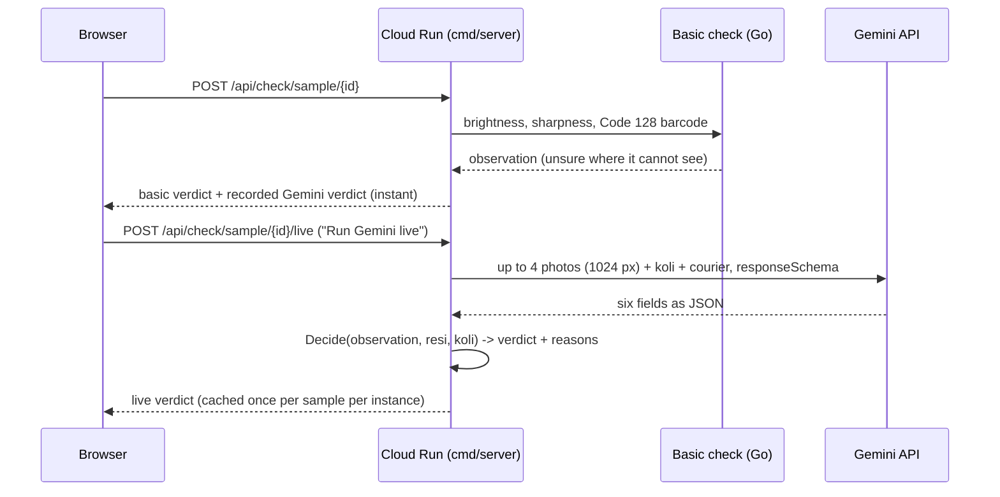
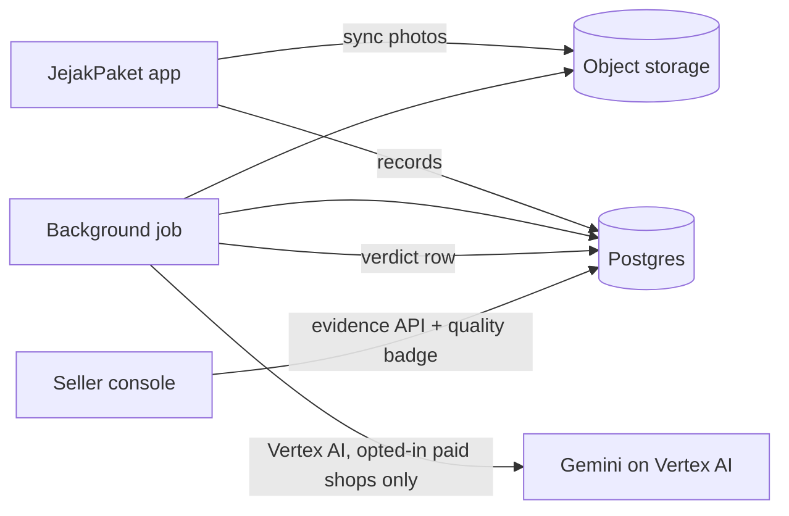

# Architecture

## Demo (this repo, on Cloud Run)

- Uploads: `POST /api/check/upload` runs the basic check only. Photos are read into memory, checked and dropped; nothing is stored and no model is called.
- `/health` answers without calling a model.
- If Gemini fails or the free tier is busy, the sample shows the result the eval recorded for the same photos, labelled as such.

## Production (Jeejak backend, private)

The job uses this repo's `evidencecheck` package: photo selection, prompt, schema and `Decide`. It runs only for shops that opted in, records only captured after the opt-in, once per photo set, prompt version, model and media resolution, under a per-shop daily cap. Off until the privacy policy names Google Cloud as a processor.

## Request to Gemini

- System instruction and response schema: [`evidencecheck/checker.go`](../evidencecheck/checker.go).
- User text: koli count and courier name only. No tracking number, recipient, operator or shop.
- Photos: the first two and the last two packing photos by order, downscaled to 1024 px JPEG ([`evidencecheck/photos.go`](../evidencecheck/photos.go)).
- `temperature: 0`, `responseMimeType: application/json`.
